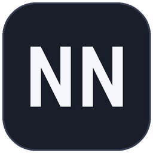
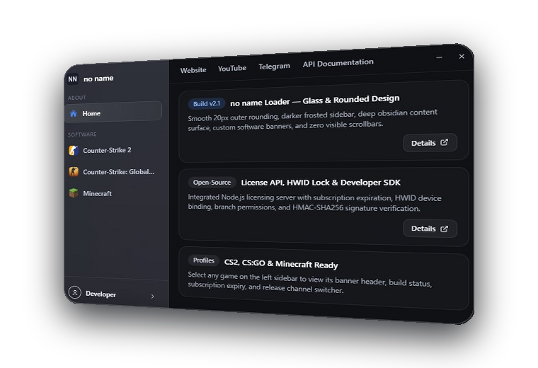

<div align="center">
  

  <h1>no name — Glassmorphic Loader & License API</h1>

  <p>
    <strong>Open-Source десктопный лоадер на Electron с матовым сайдбаром, заблюренными баннерами, проверкой подписок по HWID и сборкой в единый <code>.exe</code></strong>
  </p>

  <p>
    
    
    
    
    
  </p>

  <br />

  
</div>

<br />

## Особенности интерфейса

- **Компактное окно (`684×460`):** фиксированный размер без растягивания за углы, ровные `20px` скругления без рамок Windows DWM, скрытые скроллбары и плавные `cubic-bezier` анимации.
- **Тёмный матовый сайдбар + обсидиановый контент:** настраиваемая глубина размытия (`blur`) и затемнения боковой панели в реальном времени прямо в профиле пользователя.
- **Профили программ с баннерами:** готовые карточки для **Counter-Strike 2**, **Counter-Strike: Global Offensive** и **Minecraft** с размытыми баннерами, историей обновлений и переключением веток (`Nightly` / `Beta` / `Stable`).
- **Полноэкранный Launch Overlay:** при нажатии на **Launch** всё окно плавно размывается и отображает иконку игры, название и прогресс-бар подготовки профиля.
- **Двуязычность:** встроенный переключатель языка `EN` / `RU`.

---

## 3D Галерея экранов

<table>
  <tr>
    <td align="center" width="50%">
      
      <br />
      <sub><b>Главный экран (Home)</b> — список релизов и обзор SDK</sub>
    </td>
    <td align="center" width="50%">
      
      <br />
      <sub><b>Страница продукта</b> — баннер, статус подписки и выбор ветки</sub>
    </td>
  </tr>
</table>

---

## Защита лоадера, пользователей и License API

| Уровень защиты | Реализация |
|---|---|
| **HWID Binding** | При первой активации ключ привязывается к SHA-256 отпечатку устройства (`hostname`, `arch`, `CPU`, `MAC`). |
| **HMAC-SHA256 + Anti-Replay** | Сервер подписывает ответ; `main.js` проверяет подпись через `crypto.timingSafeEqual`, а сервер и клиент отклоняют устаревшие `issuedAt` и повторные `nonce`. |
| **Rate Limiting (Anti-Bruteforce)** | Встроенный ограничитель запросов по IP на `api-server/server.js` (защита от перебора ключей). |
| **Sandboxed Renderer + CSP** | Глобальный `app.enableSandbox()`, `contextIsolation: true`, `nodeIntegration: false`, строгий `Content-Security-Policy` в `index.html`, запрет всплывающих окон, навигации и системных разрешений. |
| **ASAR + SHA-256 Integrity + Obfuscation** | Сборка через `scripts/build.js` обфусцирует JS-файлы (`javascript-obfuscator`), генерирует `integrity.json` с SHA-256 хешами, проверяемыми при запуске, и отключает DevTools (`F12`, `Ctrl+Shift+I`) в релизе. |

---

## Быстрый старт

```bash
# 1. Установка зависимостей
npm install

# 2. Запуск локального License API сервера (порт 3840)
npm run server

# 3. Запуск лоадера (в отдельном окне терминала)
npm start

# 4. Сборка защищённого единого release/no name.exe
npm run build
```

Для быстрого запуска на Windows также доступны скрипты `start-server.bat`, `start-loader.bat` и `build-exe.bat`.

> **Демо-ключи для проверки (`api-server/licenses.json`):**
> - `NN-DEMO-2026-OPEN` — полный доступ (работает с сервером и в offline-demo режиме).
> - `NN-PRO-30D-8492` — доступ к CS2 и Minecraft (`Stable` / `Beta`) при запущенном `npm run server`.

---

## API и SDK для разработчиков

<details>
<summary><b>Эндпоинты License API (api-server/server.js)</b></summary>

### Проверка лицензии
```http
POST /api/v1/auth/verify
Content-Type: application/json

{
  "key": "NN-DEMO-2026-OPEN",
  "hwid": "A1B2C3D4E5F6...",
  "nonce": "random_hex_nonce"
}
```

### Генерация / отзыв ключей (Admin API)
```http
POST /api/v1/admin/keys
Content-Type: application/json
x-admin-secret: noname-admin-secret-change-me

{
  "action": "create",
  "username": "Customer",
  "tier": "Pro",
  "days": 30,
  "products": ["cs2", "minecraft"],
  "branches": ["Stable", "Beta"]
}
```
Поддерживаются также `action: "reset-hwid"` и `action: "revoke"`.

</details>

<details>
<summary><b>Подключение своего обработчика запуска (sdk/loader-sdk.js)</b></summary>

```js
async function executeLaunchHook({ productId, branch, session }) {
  if (!session || !session.valid) throw new Error('License required');
  if (!session.products.includes(productId)) throw new Error('Product not licensed');
  if (!session.branches.includes(branch)) throw new Error('Branch not licensed');

  // Ваш авторизованный сценарий запуска продукта
  return { ok: true, productId, branch, message: 'Ready' };
}
```

</details>

---

## Структура репозитория

```text
├── api-server/
│   ├── server.js          # Защищённый сервер проверки лицензий, Rate-Limit и HWID
│   └── licenses.json      # Хранилище ключей и подписок
├── assets/
│   ├── icon.ico / .png    # Иконка приложения NN
│   ├── cs2.png            # Иконка Counter-Strike 2
│   ├── csgo.png           # Иконка CS:GO
│   ├── minecraft.png      # Иконка Minecraft
│   ├── banner-*.jpg       # Баннеры страниц игр
│   └── preview-*-3d.png   # 3D превью для README
├── sdk/
│   └── loader-sdk.js      # Конфигурация продуктов и хук запуска
├── scripts/
│   ├── build.js           # Сборщик (obfuscation + SHA-256 manifest + single EXE)
│   └── afterPack.js       # Вшивка иконки и метаданных через rcedit
├── start-server.bat       # Быстрый запуск сервера лицензий
├── start-loader.bat       # Быстрый запуск клиента
├── build-exe.bat          # Сборка релизного .exe
├── main.js                # Основной процесс Electron + Sandbox + Integrity Check
├── preload.js             # Безопасный IPC-мост
├── index.html             # Разметка интерфейса + CSP
├── styles.css             # Стили, блюр и анимации
└── renderer.js            # Логика UI
```

---

<div align="center">
  <sub>Распространяется по лицензии <a href="LICENSE">MIT</a> • Создано на базе <b>no name UI</b></sub>
</div>
