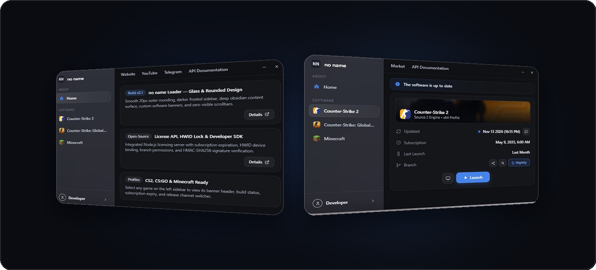

<div align="center">
  

  <h1>no name — Glassmorphic Loader & Ed25519 License Backend</h1>

  <p>
    <strong>Open-Source десктопный лоадер на Electron с матовым сайдбаром, заблюренными баннерами, асимметричной Ed25519-авторизацией, SQLite аналитикой и админ-панелью</strong>
  </p>

  <p>
    
    
    
    
    
  </p>

  <br />

  
</div>

<br />

## Особенности интерфейса

- **Компактное окно (`684×460`):** фиксированный размер без растягивания за углы, ровные `20px` скругления без рамок Windows DWM, скрытые скроллбары и плавные `cubic-bezier` анимации.
- **Тёмный матовый сайдбар + обсидиановый контент:** настраиваемая глубина размытия (`blur`) и затемнения боковой панели в реальном времени прямо в профиле пользователя.
- **Профили программ с баннерами:** готовые карточки для **Counter-Strike 2**, **Counter-Strike: Global Offensive** и **Minecraft** с размытыми баннерами, историей обновлений и переключением веток (`Nightly` / `Beta` / `Stable`).
- **Полноэкранный Launch Overlay:** при нажатии на **Launch** всё окно плавно размывается и отображает иконку игры, название и прогресс-бар серверной авторизации.
- **Двуязычность:** встроенный переключатель языка `EN` / `RU`.

---

## 3D Галерея экранов

<table>
  <tr>
    <td align="center" width="50%">
      
      <br />
      <sub><b>Главный экран (Home)</b> — список релизов и обзор SDK</sub>
    </td>
    <td align="center" width="50%">
      
      <br />
      <sub><b>Страница продукта</b> — баннер, статус подписки и выбор ветки</sub>
    </td>
  </tr>
</table>

---

## Архитектура безопасности (без секретов на клиенте)

| Уровень защиты | Реализация |
|---|---|
| **Asymmetric Ed25519 (No Client Secrets)** | Приватный ключ подписи (`ED25519_PRIVATE_KEY`) и `ADMIN_SECRET` хранятся только на сервере в `api-server/.env` (генерируются через `npm run setup`, не зашиты в код). В клиент попадает только **публичный ключ** (`sdk/public-config.json`), которым невозможно подделать ответ сервера. |
| **Locked API URL + Anti-Proxy / TLS Pinning** | В собранном `.exe` игнорируются `NONAME_API_URL`, `HTTP_PROXY` и `HTTPS_PROXY`, что блокирует перенаправление трафика через `.env` или локальные прокси. Поддерживается `pinnedCertSha256` для HTTPS. |
| **SQLite Backend + Server-Side Launch Tickets** | База `api-server/database.sqlite` (`node:sqlite`) хранит ключи, привязку **HWID**, серверные сессии и аналитику. Кнопка **Launch** запрашивает у бэкенда свежий `Ed25519`-подписанный тикет на `30` секунд (`POST /api/v1/software/authorize`), никаких оффлайн-обходов нет. |
| **Anti-Replay + Rate Limiting** | Сервер кэширует `nonce`, клиент проверяет `issuedAt` (`< 60s`), IP-лимитер ограничивает перебор ключей (`429`). |
| **Anti-Debug & Anti-Analysis (Electron)** | Проверка флагов `--inspect` / `--remote-debugging-port`, защитная проверка активных отладчиков/снифферов (`IDA`, `x64dbg`, `Wireshark`, `Fiddler`, `dnSpy`) в релизе с отправкой события `anti_tamper_alert` в аналитику сервера. |
| **Sandbox + CSP + ASAR Integrity + Obfuscation** | `app.enableSandbox()`, `contextIsolation: true`, `nodeIntegration: false`, строгий `Content-Security-Policy`, обфускация релизного JS и проверка `SHA-256` манифеста `integrity.json` при старте. |

---

## Быстрый старт и настройка под свой проект

```bash
# 1. Установка зависимостей
npm install

# 2. Генерация вашей уникальной пары ключей Ed25519 и ADMIN_SECRET
npm run setup

# 3. Запуск SQLite-бэкенда и Админ-панели (порт 3840)
npm run server

# 4. Запуск лоадера (в другом окне терминала)
npm start

# 5. Сборка защищённого единого .exe (только клиент + Public Key, без бэкенда)
npm run build
```

Для быстрого запуска на Windows также доступны `start-server.bat`, `start-loader.bat` и `build-exe.bat`.

### Админ-панель и аналитика
После запуска `npm run server` откройте в браузере:
`http://127.0.0.1:3840/admin`
- Введите `ADMIN_SECRET` из автоматически созданного `api-server/.env`.
- Управляйте подписками: создание ключей (`7d` / `30d` / `90d` / `Lifetime`), выбор продуктов и веток, сброс `HWID`, отзыв/восстановление ключей и живой журнал событий (входы, запуски, несовпадения HWID, алерты защиты).
- Стартовый тестовый ключ в базе: `NN-DEMO-2026-OPEN`.

---

## API и SDK для разработчиков

<details>
<summary><b>Эндпоинты Backend API (api-server/server.js)</b></summary>

### 1. Авторизация и привязка HWID
```http
POST /api/v1/auth/verify
Content-Type: application/json

{
  "key": "NN-DEMO-2026-OPEN",
  "hwid": "DEVICE_SHA256_HWID",
  "nonce": "random_hex_nonce"
}
```
Возвращает подписанный `ED25519_PRIVATE_KEY` объект `payload` с `sessionId` и `signature`.

### 2. Серверная авторизация запуска продукта
```http
POST /api/v1/software/authorize
Content-Type: application/json

{
  "sessionId": "...",
  "hwid": "DEVICE_SHA256_HWID",
  "productId": "cs2",
  "branch": "Nightly",
  "nonce": "random_hex_nonce"
}
```
Проверяет активную сессию, HWID, статус отзыва ключа, срок подписки, доступ к игре/ветке, записывает событие в аналитику и выдаёт `Ed25519`-подписанный тикет на запуск (TTL 30 сек).

### 3. Управление ключами (Admin API)
```http
POST /api/v1/admin/keys
Content-Type: application/json
x-admin-secret: YOUR_GENERATED_ADMIN_SECRET

{
  "action": "create",
  "username": "Customer",
  "tier": "Pro",
  "days": 30,
  "products": ["cs2", "minecraft"],
  "branches": ["Stable", "Beta"]
}
```
Поддерживаются `create`, `reset-hwid`, `revoke`, `unrevoke`, `delete`.

</details>

<details>
<summary><b>Подключение своего обработчика запуска (sdk/loader-sdk.js)</b></summary>

```js
async function executeLaunchHook({ productId, branch, ticketPayload, ticketSignature }) {
  if (!verifyEd25519Signature(ticketPayload, ticketSignature)) {
    throw new Error('Invalid Ed25519 launch ticket signature');
  }
  if (!ticketPayload.authorized || Date.now() > ticketPayload.ticketExpiresAt) {
    throw new Error('Launch ticket invalid or expired');
  }

  // Ваш авторизованный сценарий запуска продукта
  return { ok: true, productId, branch, message: 'Authorized by backend' };
}
```

</details>

---

## Структура репозитория

```text
├── api-server/
│   ├── server.js          # Backend API, Admin UI, Rate-Limiter и Ed25519 подписи
│   ├── db.js              # SQLite хранилище (licenses, sessions, analytics_events)
│   └── admin.html         # Веб-панель администратора и аналитики (/admin)
├── assets/
│   ├── icon.ico / .png    # Иконка приложения NN
│   ├── cs2.png            # Иконка Counter-Strike 2
│   ├── csgo.png           # Иконка CS:GO
│   ├── minecraft.png      # Иконка Minecraft
│   ├── banner-*.jpg       # Баннеры страниц игр
│   └── preview-*-3d.png   # 3D превью для README
├── sdk/
│   ├── loader-sdk.js      # Проверка Ed25519-тикетов и хук запуска
│   └── public-config.json # Публичный ключ Ed25519 и URL API (без секретов)
├── scripts/
│   ├── setup-keys.js      # Генератор пары ключей Ed25519 и ADMIN_SECRET
│   ├── build.js           # Сборщик (obfuscation + SHA-256 manifest + single EXE)
│   └── afterPack.js       # Вшивка иконки и метаданных через rcedit
├── start-server.bat       # Быстрый запуск сервера и админ-панели
├── start-loader.bat       # Быстрый запуск клиента
├── build-exe.bat          # Сборка релизного .exe
├── main.js                # Основной процесс Electron + Sandbox + Anti-Analysis
├── preload.js             # Безопасный IPC-мост
├── index.html             # Разметка интерфейса + CSP
├── styles.css             # Стили, блюр и анимации
└── renderer.js            # Логика UI
```

---

<div align="center">
  <sub>Распространяется по лицензии <a href="LICENSE">MIT</a> • <b>no name</b></sub>
</div>
