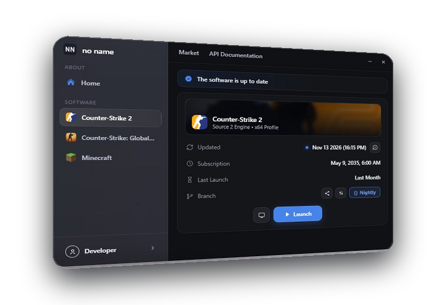
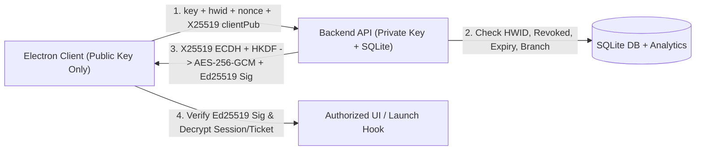

<div align="center">
  

  <h1>no name</h1>

  <p>
    Open-source десктопный лоадер на Electron с матовым интерфейсом, асимметричной криптографией <b>X25519 + Ed25519 + AES-256-GCM</b>, базой <b>SQLite</b>, веб-админкой и аналитикой.
  </p>

  <p>
    
    
    
    
    
  </p>

  <br />

  
</div>

<br />

## Обзор интерфейса

- **Фиксированное окно (`684×460`):** безрамочный дизайн с ровными `20px` скруглениями без артефактов Windows DWM, скрытым скроллбаром и запретом изменения размера.
- **Тёмный матовый сайдбар + обсидиановая панель:** живые ползунки размытия (`blur`) и затемнения бокового меню.
- **Профили игр с баннерами:** страницы **Counter-Strike 2**, **Counter-Strike: Global Offensive** и **Minecraft** с размытыми баннерами, списком изменений и переключением веток (`Nightly`, `Beta`, `Stable`).
- **Launch Overlay:** полноэкранный заблюренный экран авторизации запуска с прогресс-баром и статусом тикета.
- **Локализация:** мгновенное переключение `EN` / `RU`.

---

## 3D Галерея

<table>
  <tr>
    <td align="center" width="50%">
      
      <br />
      <sub><b>Home</b> — журнал обновлений и документация SDK</sub>
    </td>
    <td align="center" width="50%">
      
      <br />
      <sub><b>Software</b> — баннер продукта, срок подписки и выбор ветки</sub>
    </td>
  </tr>
</table>

---

## Криптография и защита архитектуры

В проекте **нет секретов на клиенте** и нет оффлайн-обходов. Каждый вход и каждый запуск продукта подтверждаются сервером в зашифрованном конверте:



| Механизм защиты | Как работает |
|---|---|
| **Zero Client Secrets (Ed25519)** | Приватный ключ подписи и `ADMIN_SECRET` хранятся только на сервере в `api-server/.env` (генерируются через `npm run setup`, исключены из Git и сборки). Клиент содержит лишь публичный ключ (`sdk/public-config.json`), которым невозможно подделать тикет. |
| **E2E Шифрование (X25519 + AES-256-GCM)** | На каждый запрос клиент генерирует одноразовую пару `X25519`. Сервер выводит общий ключ через `ECDH + HKDF-SHA256`, шифрует ответ алгоритмом `AES-256-GCM` и подписывает конверт ключом `Ed25519`. |
| **Защита от подмены IP и прокси** | В релизной сборке URL сервера зафиксирован в `sdk/public-config.json`, а прямые агенты `http.Agent` / `https.Agent` игнорируют `HTTP_PROXY` / `HTTPS_PROXY` и поддерживают `pinnedCertSha256`. |
| **SQLite + Session Heartbeat** | Сервер отслеживает активные сессии, блокирует повторные `nonce` и каждые 60 секунд перепроверяет статус через `/api/v1/auth/heartbeat` (при отзыве ключа в админке клиент выйдет сам). |
| **Hardened Admin Auth** | Вход в `/admin` сверяет `SHA-512` хеш через `crypto.timingSafeEqual`, блокирует IP на 15 минут после 5 неверных попыток (`admin_bruteforce_blocked`), выдаёт временный `Bearer`-токен (30 мин, привязка к IP и User-Agent) и защищён строгим CSP без `inline`-скриптов. |
| **Anti-Debug & Integrity** | Блокируются `--inspect` / `--remote-debugging-port`, DevTools (`F12`, `Ctrl+Shift+I`), отладчики/снифферы в релизе (с телеметрией на сервер), включён `app.enableSandbox()`, JS обфусцирован (`RC4` + `controlFlowFlattening`), а `SHA-256` манифест `integrity.json` проверяется при старте. |

---

## Установка и запуск

```bash
# 1. Установка зависимостей
npm install

# 2. Генерация вашей уникальной пары ключей Ed25519 и ADMIN_SECRET
npm run setup

# 3. Запуск SQLite-сервера и веб-админки (порт 3840)
npm run server

# 4. Запуск лоадера (в другом окне терминала)
npm start

# 5. Сборка защищённого единого release/no name.exe (v2.2.0)
npm run build
```

Для запуска в один клик на Windows предусмотрены `start-server.bat`, `start-loader.bat` и `build-exe.bat`.

---

## Админ-панель и монитор трафика

После запуска `npm run server` откройте:
`http://127.0.0.1:3840/admin`

По умолчанию доступ к `/admin` и `/api/v1/admin/*` разрешён только с локального хоста (`ADMIN_ALLOWED_IPS=127.0.0.1,::1` в `api-server/.env`).

1. Скопируйте `ADMIN_SECRET` из автоматически созданного `api-server/.env`.
2. Авторизация работает по схеме **Challenge-Response**: браузер запрашивает одноразовый nonce (`/api/v1/admin/challenge`), вычисляет локально `HMAC-SHA256(SHA-512(ADMIN_SECRET), challenge)` и отправляет только доказательство (сырой секрет по сети не передаётся).
3. Сессия защищена cookie `HttpOnly; SameSite=Strict`, заголовком `X-CSRF-Token` на все `POST`-запросы, привязкой к IP и User-Agent (anti-hijack), коротким TTL (10 мин бездействия / 30 мин максимум) и авто-блокировкой IP при переборе пароля.
4. Вкладки панели:
   - **Licenses & Creation:** выпуск ключей (`7d` / `30d` / `90d` / `Lifetime`), выдача прав на игры и ветки, сброс HWID, отзыв и удаление ключей.
   - **Traffic & Connections:** журнал всех входящих API-запросов в реальном времени (метод, путь, статус HTTP, задержка в `ms`, IP, User-Agent, заметка), метрики `RPM` и `Avg Latency`, фильтрация, экспорт в JSON и очистка.
   - **Active Sessions & IP Bans:** онлайн-сессии с HWID, ключом и IP (кнопка мгновенного кика `Kick`), а также файрвол IP-банов (`Ban` / `Unban`, блокировка с ответом `403`).
   - **Security & Event Logs:** аудит входов, ошибок HWID, авторизаций запусков, срабатываний CSRF/anti-hijack и алертов анти-тампера.

> Демо-ключ при первом запуске базы: `NN-DEMO-2026-OPEN`.

---

## API и SDK справочник

<details>
<summary><b>Эндпоинты Backend API (api-server/server.js)</b></summary>

| Метод | Путь | Назначение |
|---|---|---|
| `GET` | `/api/v1/health` | Статус сервера, БД и криптографии |
| `POST` | `/api/v1/auth/verify` | Проверка ключа, привязка HWID, выдача зашифрованной сессии |
| `POST` | `/api/v1/auth/heartbeat` | Проверка активности сессии каждые 60 сек |
| `POST` | `/api/v1/software/authorize` | Выдача 30-секундного `X25519+Ed25519` тикета на запуск продукта |
| `POST` | `/api/v1/telemetry` | Логирование событий безопасности клиента |
| `GET` | `/api/v1/admin/challenge` | Выдача одноразового nonce для Challenge-Response входа админа |
| `POST` | `/api/v1/admin/login` | Вход администратора (HMAC proof + `HttpOnly` cookie + `csrfToken`) |
| `POST` | `/api/v1/admin/logout` | Завершение админ-сессии и очистка cookie |
| `GET` | `/api/v1/admin/analytics` | Сводка статистики (`RPM`, latency), ключи, активные сессии, логи трафика и баны IP |
| `POST` | `/api/v1/admin/keys` | Действия: `create`, `reset-hwid`, `revoke`, `unrevoke`, `delete` |
| `POST` | `/api/v1/admin/sessions/kick` | Принудительное завершение активной клиентской сессии |
| `POST` | `/api/v1/admin/ips` | Файрвол IP: `ban` / `unban` |
| `POST` | `/api/v1/admin/logs/clear` | Очистка журналов трафика и событий |

</details>

<details>
<summary><b>Интеграция собственного запуска (sdk/loader-sdk.js)</b></summary>

```js
async function executeLaunchHook({ productId, branch, ticketPayload }) {
  if (!ticketPayload.authorized || ticketPayload.productId !== productId || ticketPayload.branch !== branch) {
    throw new Error('Launch ticket mismatch');
  }
  if (Date.now() > Number(ticketPayload.ticketExpiresAt || 0)) {
    throw new Error('Launch ticket expired');
  }

  // Авторизованная логика запуска вашего приложения
  return { ok: true, productId, branch, message: 'Authorized by backend' };
}
```

</details>

---

## Структура проекта

```text
├── api-server/
│   ├── server.js          # Backend API, X25519+Ed25519 движок, защита админки
│   ├── db.js              # SQLite (licenses, sessions, analytics_events)
│   ├── admin.html         # Интерфейс админ-панели (/admin) с CSP
│   └── admin.js           # Логика админ-панели без inline-скриптов
├── assets/
│   ├── icon.ico / .png    # Иконка приложения NN
│   ├── cs2.png / csgo.png / minecraft.png
│   ├── banner-*.jpg       # Баннеры программ
│   └── preview-*-3d.png   # 3D рендеры для README
├── sdk/
│   ├── loader-sdk.js      # Расшифровка конвертов и хук запуска
│   └── public-config.json # Публичный ключ Ed25519 и URL API
├── scripts/
│   ├── setup-keys.js      # Генератор ключей Ed25519 и ADMIN_SECRET
│   ├── build.js           # Обфускатор + SHA-256 манифест + portable EXE
│   └── afterPack.js       # Вшивка иконки и метаданных
├── start-server.bat       # Запуск бэкенда
├── start-loader.bat       # Запуск лоадера
├── build-exe.bat          # Сборка релиза
├── main.js                # Electron Main + Sandbox + Anti-Analysis + Heartbeat
├── preload.js             # Изолированный contextBridge
├── index.html             # UI + Content-Security-Policy
├── styles.css             # Стили, блюр и анимации
└── renderer.js            # Клиентская логика UI
```

---

<div align="center">
  <sub>MIT License • <b>no name</b></sub>
</div>
